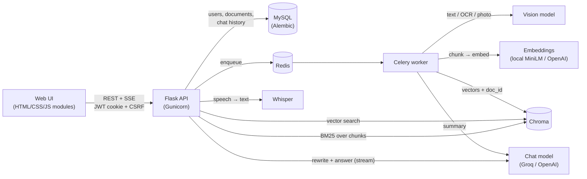

# PDF RAG Agent

[](https://github.com/Akashsingh7317/pdf-rag-agent/actions/workflows/ci.yml)

Chat with your documents: large PDFs (500+ pages, even scanned ones), Word files, text files
and photos. Ask one file or all of them at once, by typing or by voice, in English or Hinglish.
Answers stream in, use only your files, and cite the file and page for every fact.

**Stack:** Python · Flask · LangChain · Groq / OpenAI · ChromaDB + BM25 · Celery · Redis · MySQL · Alembic · JWT · Docker

Runs **free** with Groq and a local embedding model, or on OpenAI by changing two settings.

---

## Features

**Ask**
- **One file or all of them.** Pick a document, or *All documents* to get one answer drawn from
  every file, with `(report.pdf, p. 12)` citations.
- **Hybrid search.** Vector search (meaning) and BM25 keyword search (exact codes, numbers,
  names) merged with Reciprocal Rank Fusion. Measured, not assumed: see [Evaluation](#evaluation).
- **Cited, grounded answers.** Every fact carries a clickable citation that shows the source
  passage; PDF citations open the original file at that page. If the files don't contain the
  answer, it says so instead of guessing.
- **Follow-ups work.** "What about the second one?" is rewritten into a standalone question
  from the chat history before searching.
- **Voice questions.** Click the mic, speak, and Whisper turns it into text you can check before
  sending.
- **Answers in your language.** A Hinglish question written in Roman letters gets a Hinglish
  answer in Roman letters; the script is detected in code, not left to the model.

**Add**
- **PDF, Word, text and photos** through a `+` button or drag-and-drop, up to 200 MB.
- **Scanned PDFs (OCR).** Pages without a text layer are rendered and read by a vision model;
  pages that already have text are left alone.
- **Photos.** A vision model transcribes the text in a photo and describes it, so receipts,
  whiteboards and charts become searchable.
- **Summary and suggested questions** for every file, written right after indexing.
- **Live progress** with a readable stage ("Reading scanned page 3 of 12 with AI").
- **Duplicate detection** per user (SHA-256), and one-click retry / re-index.

**Run it for real**
- **Accounts.** Sign up / log in with JWT sessions in HttpOnly cookies plus CSRF protection
  (Bearer tokens for API clients). Every query is scoped to the logged-in user; other users'
  documents return 404. Passwords are salted scrypt hashes; login failures don't reveal which
  emails exist.
- **Database migrations** with Alembic. Existing installations are upgraded in place, and the
  first account inherits documents created before accounts existed.
- **Production stack:** Celery + Redis workers, Gunicorn, per-user rate limits in Redis, a Chroma
  server, Docker Compose with health checks, GitHub Actions CI.
- **Pluggable AI providers:** Groq or OpenAI for chat, vision and speech; OpenAI or a local CPU
  model (all-MiniLM-L6-v2 via ONNX) for embeddings. Switching the embedding model marks files
  "Needs re-index" instead of silently returning wrong results.
- **92 offline tests** that run the whole pipeline with fake models: no API key, no cost.

## Architecture



**Ingestion:** upload → hash + ownership check → queue → extract text (PDF pages; scanned pages
and photos via the vision model; Word paragraphs and tables) → ~1000-1200 character chunks with
overlap, keeping page numbers → embed in batches → one shared Chroma collection per embedding
model, every chunk tagged with its `doc_id` → summary + suggested questions.

**Question answering:** rewrite follow-ups → vector search and BM25 over the allowed documents
(one, or all of the user's ready files) → Reciprocal Rank Fusion → at most 2 chunks per page →
prompt with labelled excerpts → stream the answer → save the Q&A with its sources.

## Quick start (local, no Docker)

You need Python 3.12+ and a **free Groq API key** ([console.groq.com/keys](https://console.groq.com/keys)),
or an OpenAI key. Nothing else: SQLite and an embedded Chroma database are used by default.

**Windows:** double-click `start.bat`. **macOS / Linux:** run `./start.sh`.
On the first run it creates the virtual environment, installs everything and opens `.env` for
your key; run it again and the app opens at http://127.0.0.1:5000. Create your account and add a
file.

Manual setup:

```bash
git clone https://github.com/Akashsingh7317/pdf-rag-agent.git
cd pdf-rag-agent
python -m venv .venv
# Windows: .venv\Scripts\activate        macOS / Linux: source .venv/bin/activate
pip install -r requirements-dev.txt
cp .env.example .env          # Windows: copy .env.example .env   then set GROQ_API_KEY
python wsgi.py
```

The first upload downloads the local embedding model once (~80 MB). Database migrations run
automatically on start-up.

> **Local MySQL instead of SQLite:** `CREATE DATABASE pdf_rag;` then set
> `DATABASE_URL=mysql+pymysql://root:<password>@localhost:3306/pdf_rag` in `.env`.

## Run the full stack with Docker

```bash
cp .env.example .env          # set GROQ_API_KEY and SECRET_KEY
docker compose up --build
```

Open http://localhost:8000. Five containers start: `web` (runs `flask db upgrade`, then
Gunicorn), `worker` (Celery), `mysql`, `redis` and `chroma`. Files, the database and vectors
live in named volumes.

## Evaluation

`python -m evals.run_eval` indexes a 12-page printer manual with the app's real pipeline and
asks 30 questions whose answer pages are known: 15 paraphrased *meaning* questions ("Can I keep
the printer inside a cupboard?") and 15 *exact* questions about codes, numbers and names ("What
does error E07 mean?"). `--answers` also generates every answer with the configured LLM and
checks it contains the expected facts.

| Search | Hit@1 | Hit@5 | MRR | Hit@5 (meaning) | Hit@5 (exact) |
|---|---|---|---|---|---|
| vector | 97% | 97% | 0.97 | 100% | 93% |
| keyword (BM25) | 80% | 90% | 0.84 | 80% | 100% |
| **hybrid** | **100%** | **100%** | **1.00** | **100%** | **100%** |

With hybrid search and `openai/gpt-oss-120b` on Groq, **30/30 answers** contained the expected
facts. (Local all-MiniLM-L6-v2 embeddings, chunk size 1000, top 5 chunks.)

What the evaluation changed: the first hybrid version scored only **83% Hit@1**, below vector
search alone. Common words ("printer" in a printer manual) gave BM25 a full but meaningless
ranking, and RRF, which only looks at ranks, let it push correct pages down. Keyword search now
uses only distinctive query words (not stopwords, present in at most half of the chunks), which
brought hybrid to 100%. Answer checking also exposed that the model writes non-breaking hyphens
("1800‑123‑4567"), which break copy-paste and dialling; answers are now normalised to plain
characters.

*Caveat:* 30 questions on one document is a small benchmark, and the fix was found on this same
set. Treat it as a regression test and a sanity check, not a general accuracy claim.

## API

Every endpoint except `/api/health` and `/api/auth/*` needs a login. Browsers use the session
cookie (writes must send the `X-CSRF-TOKEN` header from the `csrf_access_token` cookie); API
clients send `Authorization: Bearer <access_token>` from the login response.

| Method | Endpoint | Description |
|---|---|---|
| `POST` | `/api/auth/register` | `{"name", "email", "password"}` → user + session |
| `POST` | `/api/auth/login` | `{"email", "password"}` → user + session |
| `POST` | `/api/auth/logout` | End the session |
| `GET` | `/api/auth/status` | Current user, and whether any account exists (first-run screen) |
| `GET` | `/api/documents` | Your documents with status, progress, stage, summary |
| `POST` | `/api/documents` | Upload PDF / DOCX / TXT / MD / PNG / JPG / WEBP (`multipart`, field `file`). `202` new, `200` duplicate |
| `GET` | `/api/documents/<id>` | One document |
| `GET` | `/api/documents/<id>/file` | The original file inline (`#page=N` opens a PDF at a page) |
| `POST` | `/api/documents/<id>/retry` | Re-process a failed document, or re-index after a model change |
| `POST` | `/api/documents/<id>/summary` | (Re)write the summary and suggested questions |
| `DELETE` | `/api/documents/<id>` | Delete the file, its vectors and chats |
| `POST` | `/api/documents/<id>/chat` | Ask one document: `{"question": "..."}`, streamed as SSE |
| `POST` | `/api/chat` | Ask across all your ready documents, streamed as SSE |
| `GET` / `DELETE` | `/api/documents/<id>/messages`, `/api/chat/messages` | Read / clear a conversation |
| `POST` | `/api/transcribe` | Speech to text (`multipart`, field `audio`) → `{"text": "..."}` |
| `GET` | `/api/health` | Health check (database) |

Errors are always `{"error": "human readable message"}` with a proper status (`400`, `401`,
`404`, `409` not ready / needs re-index, `413` too large, `415` wrong file type, `422`, `429`,
`502` AI provider failed).

```bash
TOKEN=$(curl -s -X POST localhost:5000/api/auth/login -H "Content-Type: application/json" \
  -d '{"email":"you@example.com","password":"your-password"}' | python -c "import sys,json;print(json.load(sys.stdin)['access_token'])")
curl -H "Authorization: Bearer $TOKEN" -F "file=@manual.pdf" localhost:5000/api/documents
curl -N -H "Authorization: Bearer $TOKEN" -H "Content-Type: application/json" \
  -d '{"question": "What is the warranty period?"}' localhost:5000/api/chat
```

The answer stream:

```
event: sources
data: {"sources": [{"doc_id": "…", "filename": "manual.pdf", "kind": "pdf", "page": 12, "snippet": "…"}], "search_query": "What is the warranty period?"}

event: token
data: {"text": "The warranty is 2 years "}

event: token
data: {"text": "(manual.pdf, p. 12)."}

event: done
data: {"message_id": 17}
```

## Configuration

All settings are environment variables; [.env.example](.env.example) lists every one.

| Variable | Default | Purpose |
|---|---|---|
| `LLM_PROVIDER` / `EMBEDDING_PROVIDER` | `openai` / `openai` | `groq` or `openai` / `local` or `openai` |
| `GROQ_API_KEY` / `OPENAI_API_KEY` | – | Key for the chosen provider |
| `GROQ_CHAT_MODEL` | `openai/gpt-oss-120b` | Answers, question rewriting, summaries |
| `GROQ_VISION_MODEL` | `qwen/qwen3.8-27b` | Photos and scanned pages (must accept images) |
| `GROQ_TRANSCRIBE_MODEL` | `whisper-large-v3-turbo` | Voice questions |
| `SECRET_KEY` | generated in `data/` locally | Signs login sessions. **Set it in production** |
| `DATABASE_URL` | SQLite in `./data` | Any SQLAlchemy URL, e.g. MySQL |
| `RETRIEVAL_MODE` | `hybrid` | `hybrid`, `vector` or `keyword` |
| `OCR_ENABLED` / `OCR_MAX_PAGES` | `true` / `150` | Read scanned PDF pages with the vision model |
| `SUMMARY_ENABLED` | `true` | Summary + suggested questions per file |
| `INGESTION_BACKEND` | `thread` | `thread` (local) or `celery` (production) |
| `CHROMA_HOST` / `CHROMA_PORT` | empty / `8000` | Use a Chroma server instead of the embedded one |
| `RATE_LIMIT_STORAGE_URI` | `memory://` | Redis shares limits across workers |
| `CHUNK_SIZE` / `CHUNK_OVERLAP` | `1200` / `200` | Use 1000 with local embeddings |
| `STALE_JOB_MINUTES` | `30` | A file with no progress for this long is shown as stuck and can be retried or deleted |

## Design decisions

| Decision | Why |
|---|---|
| **One Chroma collection per embedding model, filtered by `doc_id`** | A single query covers one document or all of a user's documents. Ownership is checked in SQL and Chroma only ever receives explicit document ids. Deleting a document is a filtered delete. |
| **Hybrid search with RRF, keyword side limited to distinctive words** | Vector search misses exact codes; BM25 misses paraphrases. RRF combines ranks without comparing incompatible scores; filtering common words stops BM25 noise from outranking good vector hits (found by the evaluation). |
| **JWT in an HttpOnly cookie + CSRF double-submit** | JavaScript can't read the token, so an XSS bug can't steal a session; the CSRF header blocks cross-site writes. Bearer tokens keep the API scriptable. |
| **Secure by default** | A `before_request` hook requires login on every API route except an explicit allow-list, so a new route can't be left open by accident. Other users' documents return 404, not 403, so ids can't be probed. |
| **Alembic migrations + stamping old databases** | Schema changes are versioned and repeatable on SQLite and MySQL; installations from before migrations existed are detected and upgraded without data loss. |
| **OCR only where needed** | Only pages with (almost) no text layer go to the vision model: cheaper, faster, and text pages keep their exact original text. |
| **Photos and scans become text at upload time** | The vision model runs once per file, not per question; afterwards everything uses the same text pipeline and a cheaper text model. |
| **Summaries never fail an upload** | A summary is a convenience, so its errors are logged and skipped; it can be regenerated later. |
| **Script of the answer decided in code** | Detecting Devanagari vs Roman letters in the question and instructing the model explicitly was far more reliable than asking it to "reply in the same language". |
| **Status and stage in the database** | Celery workers are separate processes; the DB is shared, survives restarts, and drives the live progress UI. |
| **SSE for streaming** | One-way server → browser; plain HTTP, proxy-friendly, no extra library. |
| **Idempotent ingestion** | Deterministic chunk ids and upserts: a Celery redelivery (`acks_late`) or a retry never duplicates chunks. |
| **Model factories** | Every model comes from `app/services/llm.py`, so providers are a config switch and tests swap in fakes. |

## Testing

```bash
pytest -q                       # 92 tests, offline, no API key
python -m evals.run_eval        # retrieval quality (offline with local embeddings)
```

The tests build real PDFs, Word files and images on the fly and cover: sign-up/login, cookie +
CSRF and Bearer auth, per-user isolation, first-account data claiming, the legacy database and
vector migration, uploads and validation for every file type, OCR of scanned pages, summaries,
hybrid retrieval (including exact-code ranking), re-indexing after a model change, streaming
chat for one and all documents, follow-up rewriting, voice transcription, stuck-job recovery,
request size limits, Devanagari keyword search, security headers, and error handling.

## Project structure

```
pdf-rag-agent/
├── app/
│   ├── __init__.py          # create_app(): config, extensions, migrations on start-up
│   ├── config.py            # every setting, from environment variables
│   ├── database.py          # Alembic upgrade, legacy data migration
│   ├── security.py          # JWT sessions and their error responses
│   ├── models.py            # User, Document, ChatMessage
│   ├── tasks.py             # background ingestion (thread pool or Celery)
│   ├── api/
│   │   ├── auth.py          # register / login / logout / status
│   │   ├── documents.py     # upload, list, file, retry, summary, delete
│   │   ├── chat.py          # streaming Q&A for one or all documents
│   │   └── voice.py         # speech to text
│   ├── services/
│   │   ├── llm.py           # chat, vision, speech and embedding model factories
│   │   ├── ingestion.py     # extract (incl. OCR) → chunk → embed → summarise
│   │   ├── retrieval.py     # vector + BM25 → RRF → diversify
│   │   ├── rag.py           # rewrite → prompt → stream answer
│   │   ├── vector_store.py  # shared Chroma collection, filtered by doc_id
│   │   ├── vision.py        # photos and scanned pages → text
│   │   ├── summary.py       # summary + suggested questions
│   │   └── file_types.py    # supported uploads + content checks
│   ├── templates/index.html
│   └── static/              # CSS + vanilla JS modules (api, markdown, voice, app)
├── migrations/              # Alembic migrations
├── evals/                   # retrieval / answer evaluation + sample manual
├── tests/
├── start.bat / start.sh     # one-click local start
├── Dockerfile / docker-compose.yml
└── wsgi.py / celery_worker.py
```

## Limitations and roadmap

- **Benchmark size:** the evaluation is one document and 30 questions; a larger, independent set
  (and an LLM-as-judge for answer faithfulness) is the next step.
- **Word and text files have no fixed pages:** their text is grouped into ~page-sized sections,
  so `(p. 3)` means the third section.
- **OCR quality and cost** depend on the vision model; very large scanned books are capped by
  `OCR_MAX_PAGES` and are subject to provider rate limits.
- **Accounts:** no password reset or email verification yet, and no sharing between users.
- **Scale:** BM25 is computed in memory per request (fine for thousands of chunks per user); for
  much larger libraries, move keyword search to a search engine or PostgreSQL full-text and
  vectors to pgvector or Qdrant.
